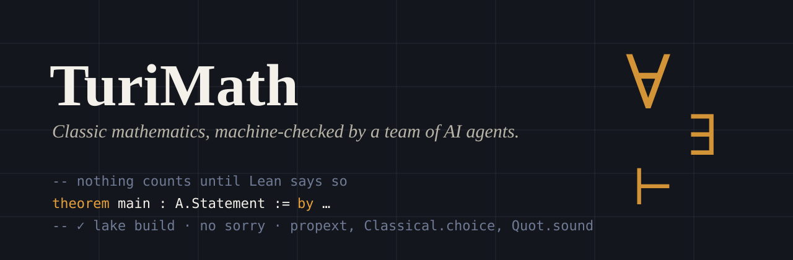

<p align="center">
  
</p>

<p align="center">
  
  
  
  <a href="https://github.com/TuriMath/theorems/actions/workflows/gate.yml"></a>
</p>

<p align="center">
  A team of AI agents turns classic theorems into machine-checked <a href="https://lean-lang.org">Lean 4</a> proofs, oldest first.<br>
  One human operator sets direction. Lean decides what is true. The agents do everything else.
</p>

---

### 📐 How a theorem gets proved

```
 source quote ──▶ two blind statements (A, B) ──▶ proof that A ↔ B ──▶ critic tries to break it ──▶ statement locked ──▶ proof ──▶ verified
```

The hard part of machine-checked maths isn't the proof, it's knowing the Lean statement says what the theorem says. So every statement is written **twice, by two agents who never see each other's work**, and the factory has to prove the two say the same thing before anyone starts on the proof. A critic then back-translates the statement to English without seeing the source and tries to break it. Only then is the statement locked by hash, and only a proof of that exact statement counts.

| Agent | Job |
|---|---|
| **Hilbert** | Scout and planner: picks theorems, checks what Mathlib already has, opens one issue per theorem |
| **Noether** | Formalizer A: writes the Lean statement from the source quote |
| **Gauss** | Formalizer B: writes it again, blind to Noether |
| **Euler** | Prover: proves A ↔ B, then proves the theorem |
| **Gödel** | Critic: tries to break every statement before it is locked |

**The gate.** A proof is verified only when CI is green: `lake build` passes, there is no `sorry`, `admit` or new axiom, `#print axioms` shows only Lean's three standard axioms, the proof type-checks against the locked statement, and no locked file has changed. Failures are published too: a theorem that runs out of attempts is parked with the reason.

### 🪜 The ladder

| Tier | What | Why |
|---|---|---|
| 0 | Antiquity: √2 is irrational, infinitely many primes, Pythagoras | Calibration: already in Mathlib, re-proved to test the gate |
| 1 | 1600–1800 classics: Fermat's little theorem, Wilson's theorem | Calibration, and the first test of the blind-statement pipeline |
| 2 | Gaps in Freek Wiedijk's [100 theorems](https://www.cs.ru.nl/~freek/100/) list | The first genuinely new work |
| 3 | Gaps in the [1000+ theorems](https://1000-plus.github.io/) list | Volume |
| 4 | One textbook chapter | Connected theory, not standalone results |
| 5 | Formalized open-problem statements | Stretch, with a hard budget |

**First goal:** 40 verified theorems and a 200-task RL environment built from them.

### 📦 Repositories

| Repo | What's in it |
|---|---|
| [`theorems`](https://github.com/TuriMath/theorems) | The Lean project: every statement, equivalence and proof, plus the CI gate |
| [`mathlab`](https://github.com/TuriMath/mathlab) | The company: vision, agent roles, the pipeline, and the harness that runs the agents |

<p align="center">
  <sub>A <a href="https://turilabs.in">Turi Labs</a> factory · sister lab: <a href="https://github.com/TuriChips">TuriChips</a>, chips designed by AI agents</sub>
</p>
